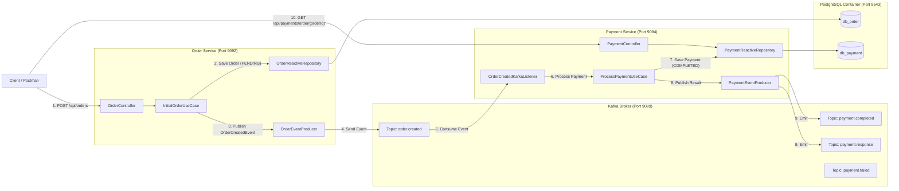

# Kafka Event-Driven Communication: Order Service & Payment Service

This guide provides end-to-end instructions for running, testing, and monitoring asynchronous event-driven communication between **Order Service** and **Payment Service** over **Apache Kafka** using Postman, Kafka CLI tools, and PostgreSQL.

---

## 1. Architecture & Event Flow



---

## 2. Kafka Topics & Event Schemas

| Topic Name | Producer | Consumer | Partitions | Purpose |
|---|---|---|---|---|
| `order.created` | `order-service` | `payment-service` | 3 | Notifies that an initial order was placed and requires payment processing. |
| `payment.response` | `payment-service` | `order-service` / Analytics | 3 | Consolidated response with payment status (`COMPLETED`, `FAILED`, `CANCELLED`). |
| `payment.completed`| `payment-service` | `order-service` | 3 | Dedicated topic for successful payments to update order status to `PAID`. |
| `payment.failed` | `payment-service` | `order-service` | 3 | Dedicated topic for failed payments (e.g., negative price, invalid user). |

### Event Payloads:

#### A. Topic: `order.created`
```json
{
  "orderId": "3fa85f64-5717-4562-b3fc-2c963f66afa6",
  "customerId": "d290f1ee-6c54-4b01-90e6-d701748f0851",
  "businessId": "c301f2ee-7c65-4b02-90e7-d802859f1962",
  "totalAmount": 200.00,
  "createdAt": "2026-11-11T13:00:00Z"
}
```

#### B. Topic: `payment.completed` / `payment.response`
```json
{
  "paymentId": "7c9e6679-7425-40de-944b-e07fc1f90ae7",
  "orderId": "3fa85f64-5717-4562-b3fc-2c963f66afa6",
  "customerId": "d290f1ee-6c54-4b01-90e6-d701748f0851",
  "price": 200.00,
  "paymentStatus": "COMPLETED",
  "failureMessages": [],
  "createdAt": "2026-11-11T13:00:01Z"
}
```

---

## 3. Step 1: Start Infrastructure Containers

Ensure Docker containers are running:
- **Kafka Broker:** Port `9099`
- **PostgreSQL (`ite-postgres`):** Port `9543` (hosts `db_order` and `db_payment`)
- **Consul (`consul-server`):** Port `8500`

```powershell
# Verify running containers
docker ps --format "table {{.Names}}\t{{.Status}}\t{{.Ports}}"
```

If Kafka or PostgreSQL are not running, start them:
```powershell
# PostgreSQL
docker compose -f deployment/postgres/docker-compose.yaml up -d

# Kafka
docker compose -f deployment/kafka/docker-compose.yaml up -d
```

Verify the Kafka topics exist:
```powershell
docker exec -i kafka-broker /opt/kafka/bin/kafka-topics.sh --bootstrap-server localhost:9099 --list
```
*(Expected output contains `order.created`, `payment.completed`, `payment.response`, `payment.failed`)*

---

## 4. Step 2: Start the Microservices

Open two terminal windows from the project root `D:\MicroserviceProject\istad-ite-project`:

### Terminal 1: Start Order Service (Port 9092)
```powershell
.\gradlew.bat :microservices:order-service:order-service-main:bootRun
```
*Wait until you see: `Netty started on port 9092 (http)`*

### Terminal 2: Start Payment Service (Port 9094)
```powershell
.\gradlew.bat :microservices:payment-service:payment-service-main:bootRun
```
*Wait until you see: `Netty started on port 9094 (http)` and `partitions assigned: [order.created-0, order.created-1, order.created-2]`*

---

## 5. Step 3: Postman Automated Testing

### Import Postman Files:
1. Open Postman.
2. Click **Import** (top left).
3. Import the following files from `microservices/postman/`:
   - Collection: [`order-payment-kafka.postman_collection.json`](file:///D:/MicroserviceProject/istad-ite-project/microservices/postman/order-payment-kafka.postman_collection.json)
   - Environment: [`istad-local.postman_environment.json`](file:///D:/MicroserviceProject/istad-ite-project/microservices/postman/istad-local.postman_environment.json)
4. In the top-right environment selector, choose **ISTAD Microservices - Local**.

---

### Test Execution Sequence:

#### Test 1: Verify Service Health
- **1.1 Check Order Service Health:** `GET http://localhost:9092/actuator/health` &rarr; Expect `status: "UP"`
- **1.2 Check Payment Service Health:** `GET http://localhost:9094/actuator/health` &rarr; Expect `status: "UP"`

#### Test 2: Execute End-to-End Kafka Flow
- **2.1 Create Order (Publishes to Kafka `order.created`):**
  - **Method:** `POST http://localhost:9092/api/orders`
  - **Body:**
    ```json
    {
      "customerId": "d290f1ee-6c54-4b01-90e6-d701748f0851",
      "businessId": "c301f2ee-7c65-4b02-90e7-d802859f1962",
      "price": 200.00,
      "items": [
        {
          "productId": "a101f3ee-8c76-4b03-90e8-e903960f2073",
          "quantity": 2,
          "price": 100.00,
          "subTotal": 200.00
        }
      ],
      "deliveryAddress": {
        "street": "123 Russian Federation Blvd",
        "postalCode": "12150",
        "city": "Phnom Penh"
      }
    }
    ```
  - **Automated Script Action:** Postman automatically extracts `jsonData.orderId` and stores it into `{{orderId}}`.
  - **Kafka Activity:** `order-service` saves the order with status `PENDING` and publishes the event to topic `order.created`.

- **2.2 Verify Payment Processed via Kafka:**
  - **Method:** `GET http://localhost:9094/api/payments/order/{{orderId}}`
  - **Automated Assertions:**
    - HTTP Status is `200 OK`
    - `jsonData.orderId` equals the generated `{{orderId}}`
    - `jsonData.paymentStatus` is `"COMPLETED"`
    - `jsonData.price` is `200.00`
  - **Automated Script Action:** Extracts and stores `jsonData.paymentId` into `{{paymentId}}`.

- **2.3 Get Payment Details by Payment ID:**
  - **Method:** `GET http://localhost:9094/api/payments/{{paymentId}}`
  - **Automated Assertions:** Confirms payment record is retrievable by primary key.

---

### Direct Payment Service REST APIs:
- **3.1 Direct Process Payment:** `POST http://localhost:9094/api/payments`
  - Tests manual payment processing, ensuring event emission to `payment.response` and `payment.completed`.
- **3.2 Verify Payment Idempotency:** Repeat `POST http://localhost:9094/api/payments` with the same `orderId`
  - Confirms system returns existing payment without double charging.
- **3.3 Test Payment Validation Failure:** `POST http://localhost:9094/api/payments` with negative price (`price: -50.00`)
  - Confirms status becomes `FAILED` and failure event is published to `payment.failed`.
- **3.4 Get All Payments:** `GET http://localhost:9094/api/payments`
  - Returns array of all recorded payments.

---

### Running with Postman Collection Runner (1-Click Automation):
1. In Postman, click on the **Order & Payment Service Kafka Flow** collection.
2. Click **Run collection** (or the blue Run button).
3. Select all requests and ensure **ISTAD Microservices - Local** is selected.
4. Click **Run Order & Payment Service Kafka Flow**.
5. All test assertions will run and show green checkmarks (Passed).

---

## 6. Step 4: Monitor Kafka Messages in Real-Time (Terminal)

To watch messages as they flow across Kafka topics, open a terminal and run Kafka Console Consumers:

### Monitor `order.created`:
```powershell
docker exec -it kafka-broker /opt/kafka/bin/kafka-console-consumer.sh `
    --bootstrap-server localhost:9099 `
    --topic order.created `
    --from-beginning `
    --property print.key=true
```

### Monitor `payment.completed`:
```powershell
docker exec -it kafka-broker /opt/kafka/bin/kafka-console-consumer.sh `
    --bootstrap-server localhost:9099 `
    --topic payment.completed `
    --from-beginning `
    --property print.key=true
```

### Monitor `payment.response`:
```powershell
docker exec -it kafka-broker /opt/kafka/bin/kafka-console-consumer.sh `
    --bootstrap-server localhost:9099 `
    --topic payment.response `
    --from-beginning `
    --property print.key=true
```

---

## 7. Step 5: Verify Records in PostgreSQL

### Query Orders Table (`db_order`):
```powershell
docker exec -i ite-postgres psql -U iteuser -d db_order -c `
  "SELECT id, customer_id, price, order_status FROM orders ORDER BY id DESC LIMIT 5;"
```

### Query Payments Table (`db_payment`):
```powershell
docker exec -i ite-postgres psql -U iteuser -d db_payment -c `
  "SELECT id, order_id, customer_id, price, status, created_at FROM payments ORDER BY created_at DESC LIMIT 5;"
```

---

## 8. Troubleshooting

| Symptom | Cause | Solution |
|---|---|---|
| `Connection refused: localhost:9099` | Kafka broker container stopped | Run `docker compose -f deployment/kafka/docker-compose.yaml up -d` |
| `Connection refused: localhost:9543` | PostgreSQL container stopped | Run `docker compose -f deployment/postgres/docker-compose.yaml up -d` |
| Postman returns `404 Not Found` on `GET /api/payments/order/{{orderId}}` | `payment-service` has not consumed the message yet or order creation failed | Verify `orderId` is populated in Postman environment and check Payment Service console logs for `Received OrderCreatedKafkaMessage`. |
| Port `9092` or `9094` already in use | Another service instance is running | Identify PID with `Get-NetTCPConnection -LocalPort 9094` and terminate it. |
