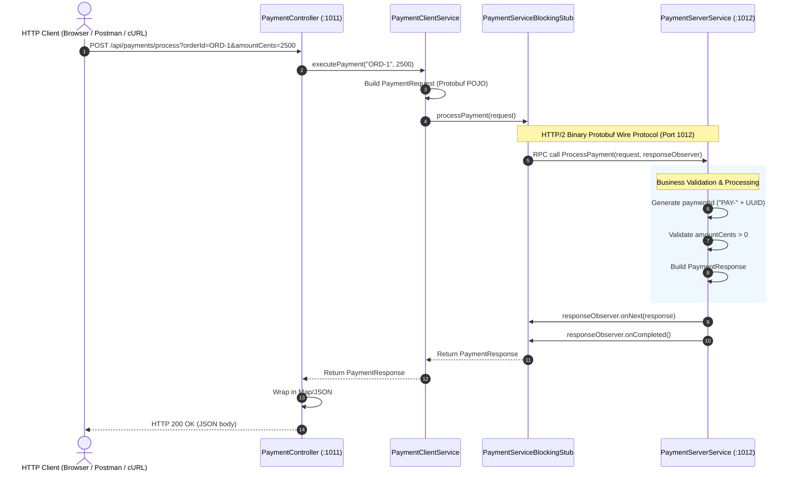
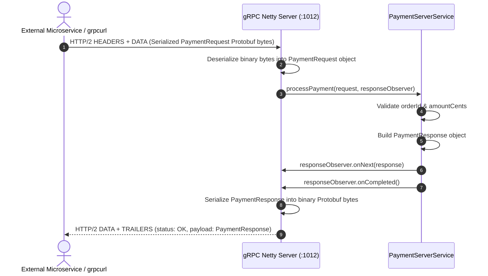

# gRPC Server Guide & Testing Instructions

This document provides a comprehensive overview of the **`grpc-server`** microservice architecture, internal execution flow, and step-by-step testing instructions.

---

## 1. Overview & Service Architecture

The `grpc-server` microservice is built using **Spring Boot 3** and **Spring gRPC (`spring-boot-starter-grpc-server` / `spring-boot-starter-grpc-client`)**. It operates in a dual role:
1. **gRPC Server** (Port `1012`): Runs on HTTP/2 using binary Protocol Buffers (Protobuf) serialization.
2. **REST API Bridge** (Port `1011`): Exposes standard HTTP REST endpoints that invoke the gRPC server internally via a generated client blocking stub.

| Component | Port / Path | Protocol | Description |
| :--- | :--- | :--- | :--- |
| **gRPC Server** | `1012` | HTTP/2 (Protobuf) | Hosts `PaymentService` defined in `payment.proto`. |
| **REST API Bridge** | `1011` | HTTP (JSON) | Translates HTTP requests to gRPC calls via a blocking stub. |
| **Protobuf Definition** | `src/main/proto/payment.proto` | Proto3 | Contract defining messages and RPC methods. |

### Protobuf Definition (`payment.proto`)
```protobuf
syntax = "proto3";
package payment;
option java_multiple_files = true;
option java_package = "com.example.grpc.payment";

service PaymentService {
  rpc ProcessPayment (PaymentRequest) returns (PaymentResponse);
}

message PaymentRequest {
  string order_id = 1;
  int64 amount_cents = 2;
}

message PaymentResponse {
  string payment_id = 1;
  string status = 2;      // "SUCCESS" or "FAILED"
  string message = 3;
}
```

---

## 2. gRPC Server Architecture & Request Flow

### 2.1 Architecture Topology

```
       [External HTTP Clients]
                 │  (HTTP / JSON on Port 1011)
                 ▼
       ┌───────────────────────────────┐
       │   PaymentController (REST)    │
       │               │               │
       │               ▼               │
       │      PaymentClientService     │
       │               │               │
       │  PaymentServiceBlockingStub   │
       └───────────────┬───────────────┘
                       │
       ┌───────────────┴───────────────┐   ◄── [External gRPC Clients / Microservices]
       │   gRPC Netty Channel (:1012)  │       (HTTP/2 Protobuf on Port 1012)
       │               │               │
       │               ▼               │
       │      PaymentServerService     │
       │     (@GrpcService on 1012)    │
       └───────────────────────────────┘
```

---

### 2.2 Component Roles

- **[`payment.proto`](src/main/proto/payment.proto)**: The single source of truth contract. Compiled by `protoc` into Java message POJOs and service stubs.
- **[`PaymentServerService`](src/main/java/kh/edu/istad/grpc/server/PaymentServerService.java)**: Implements `PaymentServiceGrpc.PaymentServiceImplBase` annotated with `@GrpcService`. Processes the payment logic and yields results to `StreamObserver<PaymentResponse>`.
- **[`PaymentClientConfig`](src/main/java/kh/edu/istad/grpc/client/PaymentClientConfig.java)**: Annotated with `@ImportGrpcClients`, sets up `PaymentServiceBlockingStub` directed at `static://127.0.0.1:1012`.
- **[`PaymentClientService`](src/main/java/kh/edu/istad/grpc/client/PaymentClientService.java)**: Spring Service wrapping the stub call with Java helper methods.
- **[`PaymentController`](src/main/java/kh/edu/istad/grpc/client/PaymentController.java)**: REST controller exposing `POST /api/payments/process`.
- **[`PaymentClientRunner`](src/main/java/kh/edu/istad/grpc/client/PaymentClientRunner.java)**: A `CommandLineRunner` triggering an initial gRPC probe at application startup.

---

### 2.3 Flow A: REST-to-gRPC Bridge Flow (`POST /api/payments/process`)

When an HTTP client calls the REST bridge endpoint:



---

### 2.4 Flow B: Direct gRPC Call Flow (Port `1012`)

When another microservice or a gRPC CLI tool (`grpcurl`, BloomRPC) calls the server directly:



---

### 2.5 Detailed Lifecycle Phases

1. **Compilation Phase (`generateProto`)**:
   - Gradle `com.google.protobuf` plugin invokes `protoc` and `protoc-gen-grpc-java`.
   - Generates classes under `build/generated/sources/proto/main/java`:
     - `PaymentRequest` & `PaymentResponse`
     - `PaymentServiceGrpc` (Service definition, base classes, stubs)
2. **Bootstrapping Phase**:
   - Spring Boot initializes Tomcat HTTP server on port `1011` (`server.port`).
   - `spring-boot-starter-grpc-server` initializes the Netty gRPC server on port `1012` (`spring.grpc.server.port`).
   - Beans annotated with `@GrpcService` are automatically bound to the gRPC registry.
   - `@ImportGrpcClients` configures a shared `ManagedChannel` and registers the `PaymentServiceBlockingStub` in the Spring context.
3. **Execution Phase**:
   - Asynchronous request handling via `StreamObserver`:
     - `responseObserver.onNext(response)` sends response message(s).
     - `responseObserver.onCompleted()` closes the stream.
     - `responseObserver.onError(throwable)` handles errors and sets gRPC status codes.

---

## 3. Running Automated Tests

Run the integration tests (verifies the entire client-stub-server roundtrip):

### From Root Project:
```powershell
.\gradlew.bat :microservices:grpc-server:test
```

### From `microservices/grpc-server` directory:
```bash
cd microservices/grpc-server
../../gradlew test
```

Test reports are generated at:
```
microservices/grpc-server/build/reports/tests/test/index.html
```

---

## 4. Starting the Server

### From Root Project:
```powershell
.\gradlew.bat :microservices:grpc-server:bootRun
```

### From `microservices/grpc-server` directory:
```bash
cd microservices/grpc-server
../../gradlew bootRun
```

---

## 5. Testing Method 1: Built-in Startup Runner

On application startup, [`PaymentClientRunner`](src/main/java/kh/edu/istad/grpc/client/PaymentClientRunner.java) automatically executes a test call:

Look for this in the console logs:
```text
INFO ... PaymentClientRunner : Testing gRPC client call to PaymentService...
INFO ... PaymentClientRunner : Received gRPC Response: paymentId=PAY-xxxx, status=SUCCESS, message=Payment of 5000 cents approved for order ORDER-12345
```

---

## 6. Testing Method 2: HTTP REST Bridge (Port 1011)

### Success Test (`amountCents > 0`):
```powershell
Invoke-RestMethod -Method Post -Uri "http://localhost:1011/api/payments/process?orderId=ORD-1001&amountCents=2500" | ConvertTo-Json
```
```bash
curl -X POST "http://localhost:1011/api/payments/process?orderId=ORD-1001&amountCents=2500"
```
**Expected Response:**
```json
{
  "orderId": "ORD-1001",
  "paymentId": "PAY-xxxxxxxx",
  "status": "SUCCESS",
  "message": "Payment of 2500 cents approved for order ORD-1001"
}
```

### Failure Test (`amountCents <= 0`):
```powershell
Invoke-RestMethod -Method Post -Uri "http://localhost:1011/api/payments/process?orderId=ORD-1002&amountCents=0" | ConvertTo-Json
```
```bash
curl -X POST "http://localhost:1011/api/payments/process?orderId=ORD-1002&amountCents=0"
```
**Expected Response:**
```json
{
  "orderId": "ORD-1002",
  "paymentId": "PAY-xxxxxxxx",
  "status": "FAILED",
  "message": "Invalid payment amount."
}
```

---

## 7. Testing Method 3: Direct gRPC (Port 1012)

### Option A: Using `grpcurl`

#### PowerShell:
```powershell
grpcurl -plaintext -proto microservices/grpc-server/src/main/proto/payment.proto -d '{\"order_id\": \"ORD-GRPC-01\", \"amount_cents\": 7500}' localhost:1012 payment.PaymentService/ProcessPayment
```

#### Bash:
```bash
grpcurl -plaintext \
  -proto microservices/grpc-server/src/main/proto/payment.proto \
  -d '{"order_id": "ORD-GRPC-01", "amount_cents": 7500}' \
  localhost:1012 payment.PaymentService/ProcessPayment
```

**Expected Response:**
```json
{
  "payment_id": "PAY-xxxxxxxx",
  "status": "SUCCESS",
  "message": "Payment of 7500 cents approved for order ORD-GRPC-01"
}
```

---

### Option B: Using Postman (gRPC Request)

1. Open **Postman** > Click **New** > **gRPC Request**.
2. Set Server URL to `localhost:1012`.
3. Under **Service definition**, choose **Import a .proto file** and select `microservices/grpc-server/src/main/proto/payment.proto`.
4. Select method: `payment.PaymentService/ProcessPayment`.
5. In **Message**, enter:
   ```json
   {
     "order_id": "ORD-POSTMAN-001",
     "amount_cents": 5000
   }
   ```
6. Click **Invoke**.

---

## 8. Troubleshooting

| Issue | Cause | Resolution |
| :--- | :--- | :--- |
| `Connection refused: localhost:1012` | gRPC server is not running | Start the server with `bootRun`. |
| `UNAVAILABLE: io exception` | Wrong port or TLS enabled | Ensure target is port `1012` with plaintext (no TLS). |
| `Cannot find symbol PaymentServiceGrpc` | Proto classes not yet generated | Run `./gradlew :microservices:grpc-server:generateProto`. |
| Port `1011` or `1012` in use | Another service instance is running | Kill the lingering process or update ports in `application.yaml`. |
