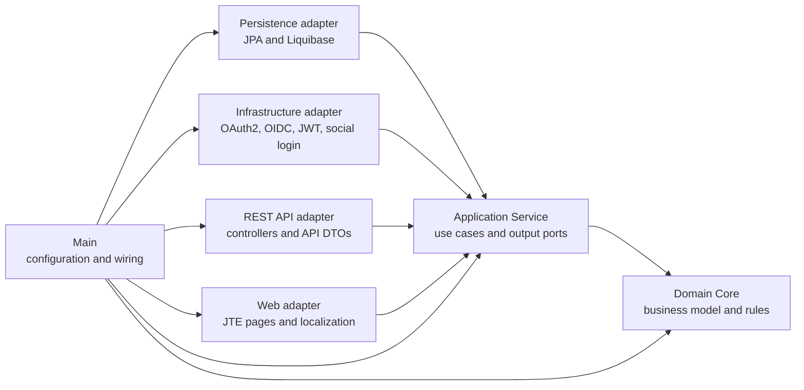

# IAM Service

Spring Authorization Server and IAM API organized with Clean Architecture, DDD, and ports and adapters.

## Architecture



| Module | Dependency rule |
| --- | --- |
| `iam-domain:iam-domain-core` | Plain Java; no framework dependencies |
| `iam-domain:iam-application-service` | API depends on domain core |
| `iam-persistence`, `iam-infrastructure`, `iam-rest-api`, `iam-web` | API depends on application service |
| `iam-main` | Composes all modules |

Use cases call application output ports. Persistence implements data ports; infrastructure implements security and authorization-server adapters. REST and web controllers translate transport data and delegate to use cases. Main provides application configuration and dependency wiring.

## Implemented features

- User, profile, role, permission, identity, and assignment domain models with account, RBAC, soft-delete, expiry, revocation, and identity rules.
- User, role, permission, and identity use cases with repository, password, current-actor, and consent ports.
- PostgreSQL schema and seed changesets, JPA entities, Spring Data repositories, mappers, and adapters.
- REST endpoints under `/api/users`, `/api/me`, `/api/roles`, `/api/permissions`, and `/api/auth/register`, including validation, method authorization, JWT authority conversion, paging, and RFC 9457 problem responses.
- Authorization code with PKCE, OIDC, UserInfo, consent management, JWT role and permission claims, and OIDC Dynamic Client Registration at `/connect/register`.
- JTE pages for login, registration, consent, account overview, profile editing, password change, linked accounts, and connected applications. English and Khmer message bundles are included; `?lang=en` and `?lang=km` select the locale.
- Google, GitHub, Facebook, and Telegram provider client configuration. Provider login requires valid provider credentials, callback allowlists, and public HTTPS callback URLs where required.

## Local setup

Requirements: Java 25, Docker, and the repository Gradle wrapper.

1. Copy `.env.example` to `.env`. Set `DB_PASSWORD`, `IAM_ADMIN_PASSWORD_HASH`, and `IAM_DCR_CLIENT_SECRET`. Add provider credentials only for providers you intend to test. `.env` is ignored by Git.
2. Set the values from `.env` in the current PowerShell process without printing them:

   ```powershell
   Get-Content .env | ForEach-Object {
       if ($_ -match '^\s*([^#][^=]*)=(.*)$') {
           [Environment]::SetEnvironmentVariable($matches[1].Trim(), $matches[2], 'Process')
       }
   }
   ```

3. Start local PostgreSQL using those credentials:

   ```powershell
   docker run --detach --name iam-postgres --publish 5432:5432 `
     --env POSTGRES_DB=iam --env POSTGRES_USER=$env:DB_USERNAME `
     --env POSTGRES_PASSWORD=$env:DB_PASSWORD postgres:16-alpine
   ```

4. Generate a BCrypt hash and put it in `.env` as `IAM_ADMIN_PASSWORD_HASH` before the first database startup. Enter a password when prompted, then copy the printed hash into `.env`:

   ```powershell
   .\gradlew.bat -p microservices/iam-service :iam-main:hashPassword -q
   ```

   The seed creates `admin` / `admin@example.com`; it does not set a default password.
5. Run the service from the repository root:

   ```powershell
   .\gradlew.bat -p microservices/iam-service :iam-main:bootRun
   ```

Liquibase initializes the schema and seed data at startup. The browser client is seeded from `IAM_BROWSER_CLIENT_ID` and `IAM_BROWSER_REDIRECT_URI`; the default redirect is Postman's OAuth callback. The DCR client is seeded only when `IAM_DCR_CLIENT_SECRET` is set. Keep that client secret private.

The sample `application.yaml` enables JTE development compilation from the web module source directory. For a packaged production deployment, configure JTE template precompilation and provide a stable authorization-server signing key; the current RSA signing key is generated at process startup and is not suitable for a multi-instance or restart-stable deployment.

## OAuth and API flow

1. Open the collection's `/api/me` request in Postman and use its OAuth 2.0 authorization-code helper. Set client ID `iam-browser`, the configured callback, scopes `openid profile email address phone`, and PKCE S256. Sign in as the seeded administrator and approve consent.
2. Call `/api/me` and the secured `/api/users`, `/api/roles`, and `/api/permissions` endpoints with that access token.
3. For Dynamic Client Registration, request a one-time client-credentials token from `/oauth2/token` using the `iam-dcr` client and exactly the `client.create` scope, then call `/connect/register` with that bearer token and an OIDC client registration document.

The collection and local environment are in `postman/`. Import both into Postman. Fill the DCR secret locally in the environment; never export or commit it. Public self-registration is `POST /api/auth/register` and does not require an access token.

For the full Postman setup, request examples, and endpoint-by-endpoint test plan, see [`postman/README.md`](postman/README.md).

## Tests

Run the full build, unit tests, persistence tests, and Testcontainers authorization-code end-to-end test:

```powershell
.\gradlew.bat -p microservices/iam-service build
```

The end-to-end test starts PostgreSQL through Testcontainers, runs Liquibase, logs in, grants consent, exchanges a PKCE authorization code, checks access/ID token claims and UserInfo, calls protected REST endpoints, renders all JTE pages, and exercises DCR. Testcontainers tests are skipped when Docker is unavailable.

## Operational notes

- Social sign-in requires provider-side client registrations and callback URLs matching `/login/oauth2/code/{registrationId}`. The app's base URL must be reachable by each provider.
- Telegram's OIDC integration returns identity claims in the ID token.
- Consent revocation removes the user's stored authorization consent for the selected client.
- Review `application.yaml` and `.env.example` for configuration names. Secret values are supplied through environment variables.
